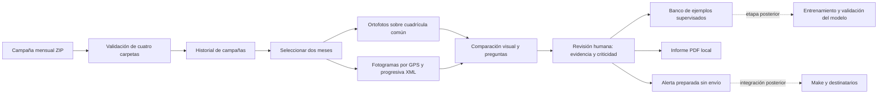

# HIDRO-VISION AI: arquitectura local

## Componentes implementados

- `docs/index.html`, `platform.css`: registro, historial, comparación y revisión.
- `comparison.js`: resultados geoespaciales, notas por progresiva y videos sincronizados.
- `zoom.js`: zoom, desplazamiento, ajuste de cobertura y pantalla completa.
- `platform.js`: registro de campañas, hallazgos, exportación, informes y preparación de alertas.
- `server.py`: API local y entrega de archivos con soporte de rangos para video.
- `processor.py`: validación de ZIP, LandXML, SRT y ortofotos; extracción y comparación.
- `platform_store.py`: persistencia SQLite, auditoría de revisiones y PDF.

## Contrato de los datos

Cada ZIP contiene `VIDEO`, `ORTOFOTO`, `PLANO_OTROS` y `XML`. Cada campaña tiene identificador, mes y año. Los planos sirven como referencias. Las progresivas provienen del alineamiento XML y los fotogramas se seleccionan por la posición del dron en el SRT.

Cada hallazgo conserva comparación, progresiva, categoría, evidencia, justificación, revisor, verificación de campo y fechas. Cada corrección produce una revisión adicional. El conjunto exportado incluye etiquetas e imágenes referenciadas, sin convertirlas en predicciones.

## Estado de la IA y las alertas

El sistema está en recopilación de ejemplos supervisados. No existe un detector entrenado, una precisión medida ni un entrenamiento automático con cada carga. El siguiente ciclo requiere revisar etiquetas, separar campañas entre entrenamiento y evaluación, entrenar, medir errores y aprobar una versión antes de usar sus predicciones.

El PDF usa una plantilla, sin LLM conectado. Las alertas quedan en SQLite con estado `prepared_not_sent`. No se realizan solicitudes a Make ni se envían correos. Para conectar Make posteriormente se requiere definir webhook, destinatarios, política de envío y acceso autorizado a los informes.

## Verificación

`python -m unittest test_comparison test_platform -v` verifica comparación geográfica, nodata de cuatro bandas, lectura de campañas, auditoría de hallazgos, exportación, PDF y alertas preparadas. El visor se verificó con las campañas reales de enero y julio de 2026.
